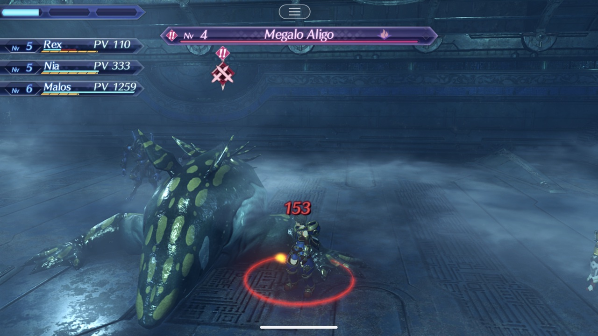
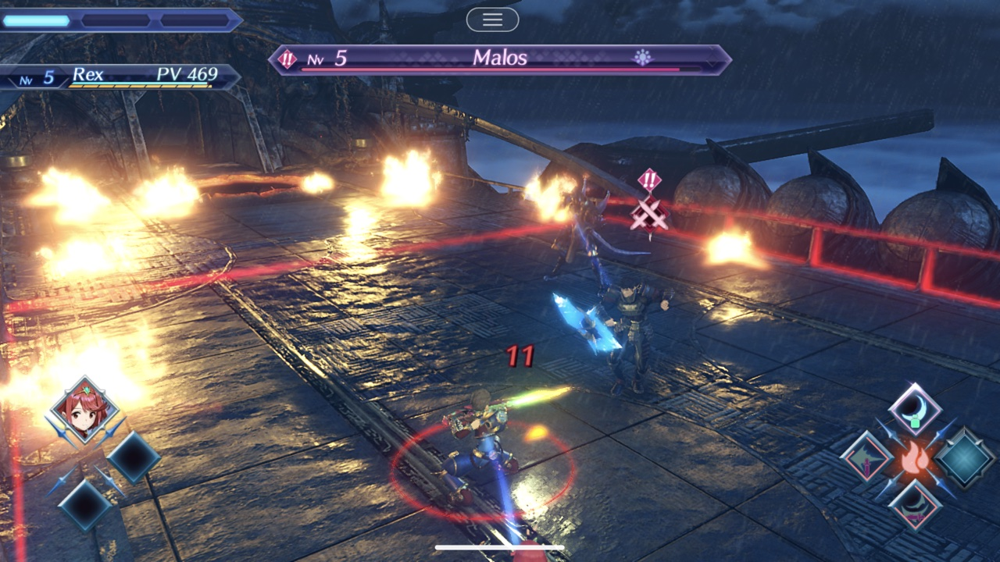

# Xenoblade Chronicles 2 on Android

**Xenoblade Chronicles 2 (Nintendo Switch) running natively on Android at 60 fps**, built from your own copy of the game
with [nx2android](https://github.com/shirai91/nx2android). The game's own program runs directly on the device's CPU (the
Switch and Android devices share the same CPU architecture); nx2android provides the Switch's system services and
replays its graphics on Vulkan.

> [!IMPORTANT]
> **No game files are included.** This repository holds no game program, data, shader, art or key, and it ships no APK
> (a built APK carries the game's icon, so it is made on your computer instead). You need your own dump of the base game
> and of update 2.1.0, and the `prod.keys` of your own console. How to dump them is not covered here. Please do not ask
> for game files or keys.

| | |
|---|---|
|  |  |

Captured on an AYN Odin 3. The text is Brazilian Portuguese because of a fan translation used on that device; it is
not part of this repository.

## Status

Tested on **one device: AYN Odin 3 (Snapdragon 8 Elite, Adreno 830, Android 15) with a Mesa Turnip driver**.

| Item | Status |
|---|---|
| Boot, title, new game, the game's own save | Works |
| Fights and the town of Argentum at 1280x720 | 60 fps (frame time p95 16.9 to 17.6 ms, GPU about 10 ms) |
| Sound | Works |
| Videos (pre-rendered scenes) | Works (tested: the first video after the tutorial fight) |
| Pause menu | Two rows made for this port: Frame rate (30 / 60) and Resolution (Low / Auto / High) |
| Later areas, long sessions, DLC content | Not tested |

Known issue: the game closed once when it lost focus (opening the Odin's side panel) in Argentum. It was not
reproduced. Change the device's performance mode with the game closed.

Not tested: any other device, Mali or other GPUs. The device's stock Qualcomm driver was only run before the final
fixes. Treat it as experimental.

## What you need

- A computer with macOS or Linux, about **35 GB of free disk space**, Python 3.11 or newer and git. (The setup script
  is a bash script and was run on macOS only. On Windows, nx2android itself works; use its own instructions with the
  branch named below.)
- An arm64 Android device with USB debugging turned on, and about **15 GB free** on it.
- Your own game files:
  - the base game, title `0100E95004038000`, v0;
  - update 2.1.0, title `0100E95004038800`, v983040;
  - optional: DLC files (the build used here included the New Quests Pack, `0100E95004039002`; DLC content was not tested);
  - your `prod.keys`.
- For a Snapdragon device, a Turnip Vulkan driver (see [drivers/](drivers/README.md)).

## Install

1. Put the base game, the update and `prod.keys` into [`put-game-files-here/`](put-game-files-here/README.txt).
2. Put the Turnip driver's `.so` file into [`drivers/`](drivers/README.md).
3. Connect the device and run:

   ```sh
   ./setup.sh
   ```

   It fetches nx2android at the tested commit and the tools nx2android needs (it asks before downloading the Android
   NDK, the .NET SDK and adb), builds the app and its data from your files and installs both. The first run takes
   several minutes on the computer, and the first install copies about 14 GB to the device.

`./setup.sh check` shows what was found and what is missing without changing anything. More detail, and what to do
when something goes wrong: [docs/INSTALL.md](docs/INSTALL.md).

## In the game

The button at the top of the screen opens nx2android's pause menu.

- **Game tab, Frame rate**: 30 or 60 fps (cutscenes stay at 30).
- **Game tab, Resolution**: lower it if frames drop.
- **Gamepad tab, Face buttons**: if A/B/X/Y feel swapped, this switches between mapping by position and by the
  button's letter.
- **Heat**: on the Odin 3, "Performance" mode keeps the GPU at its top clock all the time. In "Standard" mode the game
  held 60 fps in the fight tested.

## How this relates to nx2android

All the code is nx2android's. The changes this game needed (sound and videos on its old SDK, two graphics fixes, the
Turnip defaults, the two pause menu rows and the game's profile with its 60 fps patch) were sent to nx2android as pull
request [#403](https://github.com/shirai91/nx2android/pull/403). Until it is merged, `setup.sh` fetches the branch that
holds them. What was wrong and how it was fixed, in plain words: [docs/WHAT_WAS_FIXED.md](docs/WHAT_WAS_FIXED.md).

Earlier versions of this repository held those changes as a patch file and a profile folder to copy by hand. They are
in the pull request's branch now, and the script replaces the manual steps.

The same was done for Trails in the Sky 1st Chapter:
[trails-in-the-sky-1st-android-port](https://github.com/G0zsilva/trails-in-the-sky-1st-android-port).

## Legal

This is an unofficial fan project for people who own the game. It is not affiliated with or endorsed by Nintendo or
Monolith Soft. Xenoblade Chronicles 2 is © Nintendo / MONOLITHSOFT. See [docs/LEGAL.md](docs/LEGAL.md) and
[THIRD_PARTY.md](THIRD_PARTY.md). The script in this repository is under the [MIT license](LICENSE).
